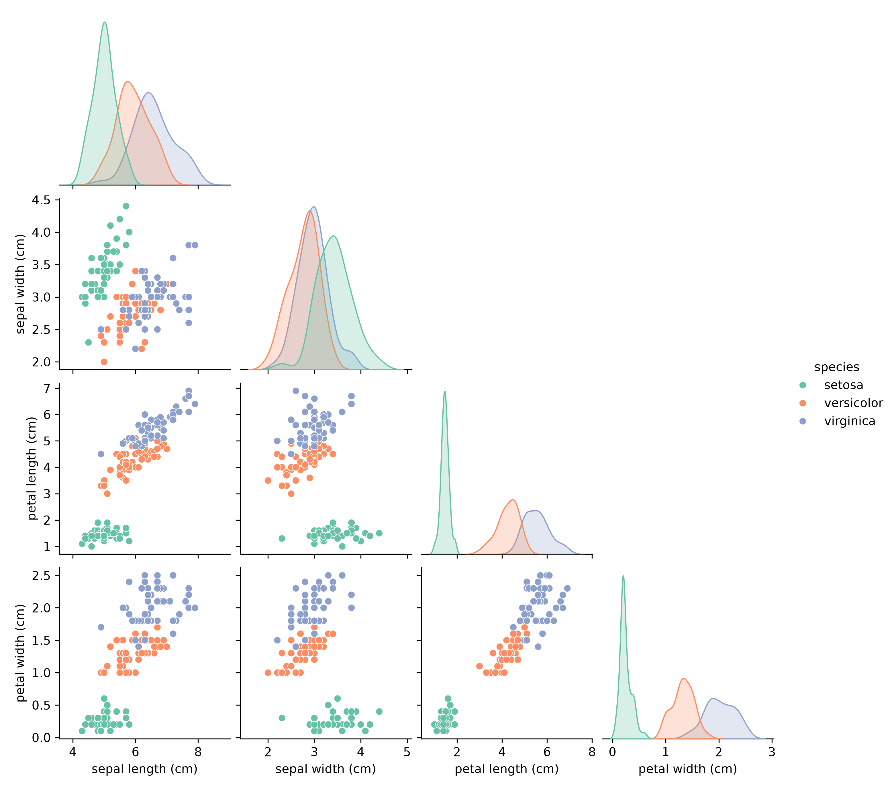
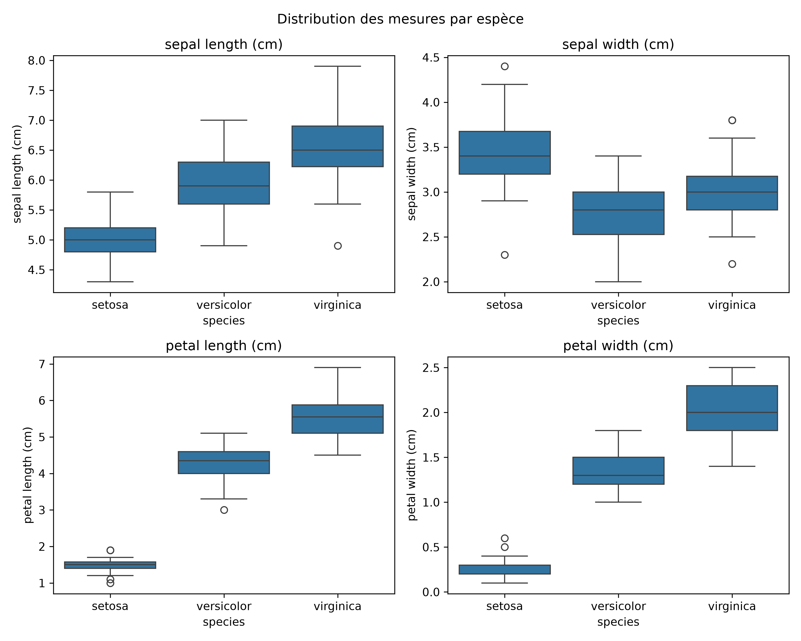
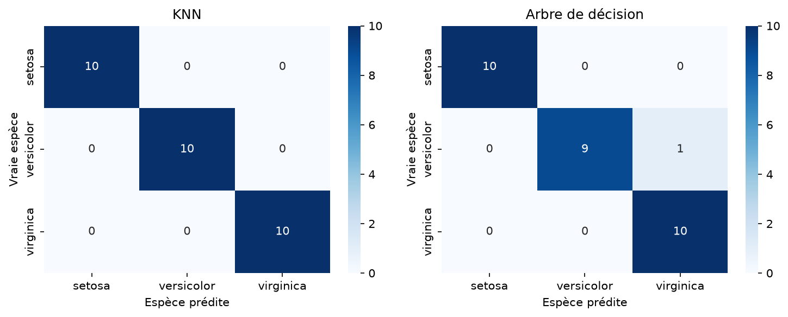

# Iris Flower Classification

**Oasis Infobyte, Data Science Internship (OIBSIP), Task 1**

## Comprendre le projet

### Le problème
Le jeu de données Iris est l'un des plus célèbres du machine learning. Il a été popularisé par le statisticien Ronald Fisher en 1936. Il décrit 150 fleurs d'iris appartenant à trois espèces : **Setosa**, **Versicolor** et **Virginica**. Pour chaque fleur, on dispose de quatre mesures en centimètres : la longueur et la largeur du sépale, la longueur et la largeur du pétale.

Un botaniste reconnaît l'espèce d'une fleur à son aspect. Ici, on demande à un ordinateur de faire la même chose en utilisant uniquement ces quatre nombres.

### Le type de tâche
Il s'agit d'un problème de **classification supervisée** : le modèle apprend à partir d'exemples dont on connaît déjà l'espèce, puis il doit prédire l'espèce de fleurs qu'il n'a jamais vues. Pour vérifier qu'il généralise bien, on garde 20 % des données de côté (le jeu de test) et on ne les utilise qu'à la fin, pour l'évaluation.

### Ce qu'on cherche à savoir
- Les espèces sont-elles faciles à distinguer à partir des mesures ?
- Quelles mesures sont les plus utiles pour les séparer ?
- Quelles espèces risquent d'être confondues ?
- Quel modèle prédit le mieux, et cette différence est-elle fiable ?

### Les deux modèles comparés
- **K-Nearest Neighbours (KNN)** : pour une nouvelle fleur, il cherche les 5 fleurs les plus proches dans les données d'entraînement et choisit l'espèce majoritaire parmi elles. Il repose sur la **distance**.
- **Arbre de décision** : il pose une suite de questions sur les mesures (par exemple « la longueur du pétale est-elle inférieure à telle valeur ? ») jusqu'à aboutir à une espèce. Il repose sur des **règles**.

Ces deux approches sont très différentes, ce qui rend leur comparaison intéressante.

### Les métriques utilisées
- **Accuracy** : la proportion de fleurs correctement classées.
- **Matrice de confusion** : un tableau qui montre, pour chaque espèce réelle, les espèces prédites. Elle indique où le modèle se trompe.
- **Precision, recall, F1** : mesurent la qualité des prédictions espèce par espèce.

## Dataset

- Chargé avec `sklearn.datasets.load_iris()`
- 150 échantillons, 50 par espèce (classes équilibrées)
- 4 variables numériques, aucune valeur manquante

## Ce que révèle l'analyse exploratoire

### Les espèces dans l'espace des mesures
Setosa forme un groupe isolé sur les pétales. Versicolor et Virginica se touchent en bordure, surtout sur les sépales. `sepal width` est la variable la moins discriminante.



### Distribution de chaque mesure par espèce
Les boîtes de Setosa sont complètement séparées sur `petal length` et `petal width`. On observe 13 outliers (méthode IQR calculée par espèce). Ils sont peu nombreux et proches des bornes, donc je les ai conservés.



## Méthodologie

1. Chargement des données dans un DataFrame pandas (150 × 6)
2. Analyse exploratoire : dimensions, types, valeurs nulles, statistiques descriptives
3. Visualisations et détection des outliers
4. Découpage train/test 80/20 (`random_state=42`, `stratify=y`)
5. Entraînement de KNN (`n_neighbors=5`) et d'un arbre de décision (`max_depth=3`, `criterion="entropy"`)
6. Évaluation des deux modèles

## Résultats

 Modèle  Accuracy (test, 30 fleurs) 

 K-Nearest Neighbours= 1.00 
 Arbre de décision = 0.97 



Setosa est parfaitement classée par les deux modèles. La seule erreur, commise par l'arbre, est une Versicolor prédite Virginica : cela confirme ce que montrait le pairplot.

## Conclusion

KNN obtient le meilleur score sur ce découpage, mais l'écart avec l'arbre est d'une seule fleur sur 30. Avec un test aussi petit et un seul découpage, cette différence n'est pas assez solide pour désigner un vainqueur définitif. (Ajoute ici les moyennes de ta validation croisée.)

## Lancer le projet

1. Créer et activer un environnement virtuel :
   ```
   python -m venv .venv
   .venv\Scripts\Activate.ps1
   ```
2. Installer les dépendances : `pip install -r requirements.txt`
3. Ouvrir `iris_classification.ipynb` et exécuter toutes les cellules

## Structure du dossier

```
DataScience-Task1-IrisClassification/
├── iris_classification.ipynb
├── README.md
├── requirements.txt
└── images/
    ├── pairplot.png
    ├── boxplots.png
    └── confusion_matrices.png
```

## Outils

Python, pandas, NumPy, scikit-learn, matplotlib, seaborn, Jupyter Notebook

## Auteur

Ton Prénom MOUTCHI MARIAMNE, www.linkedin.com/in/mariamne-adélaïde-moutchi-a5b187245