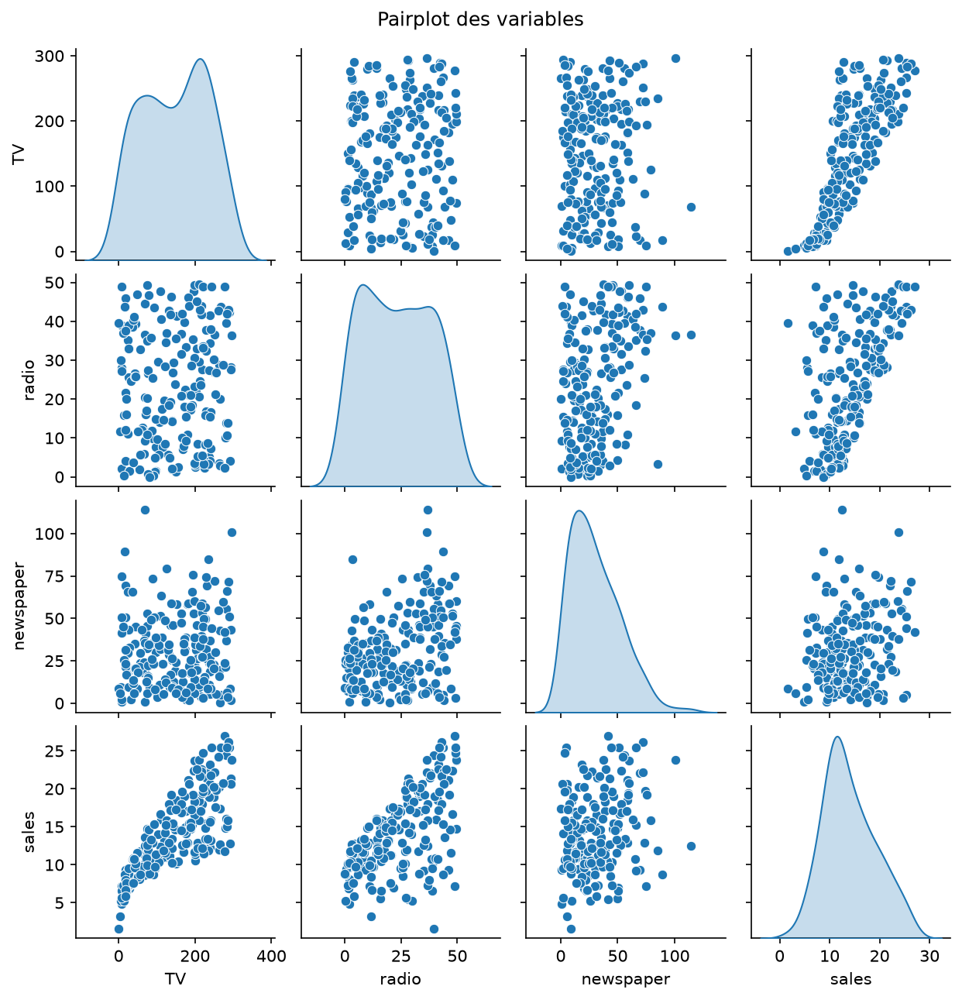
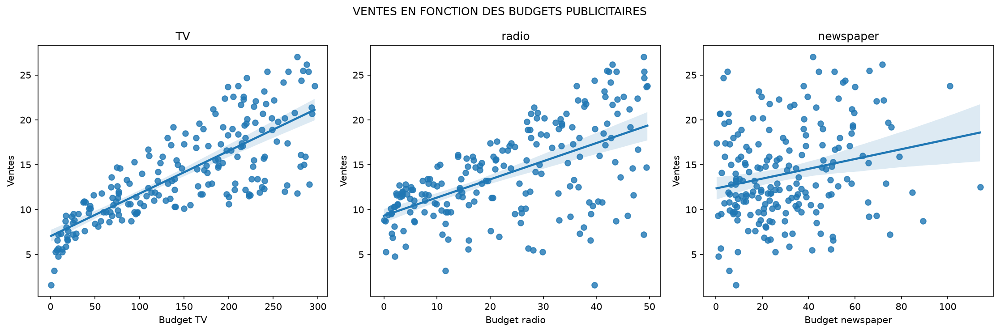
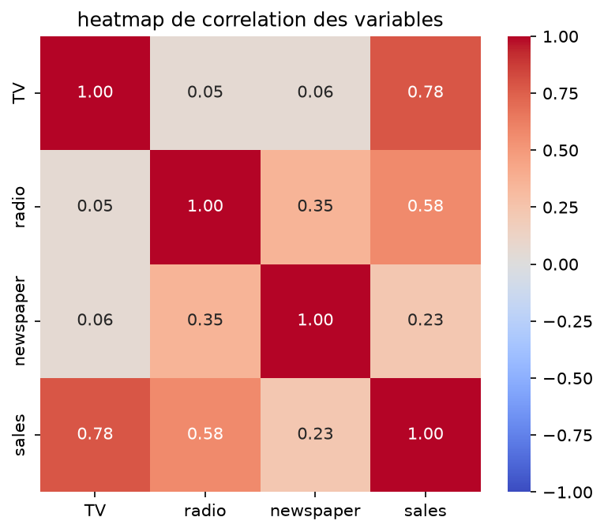
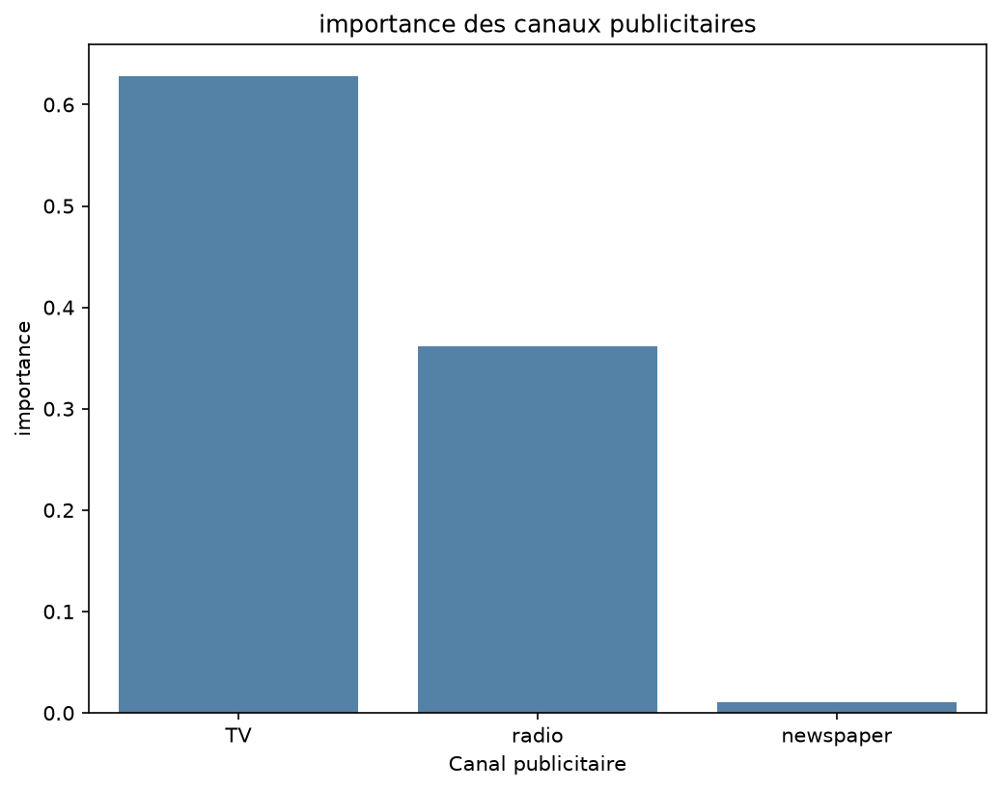
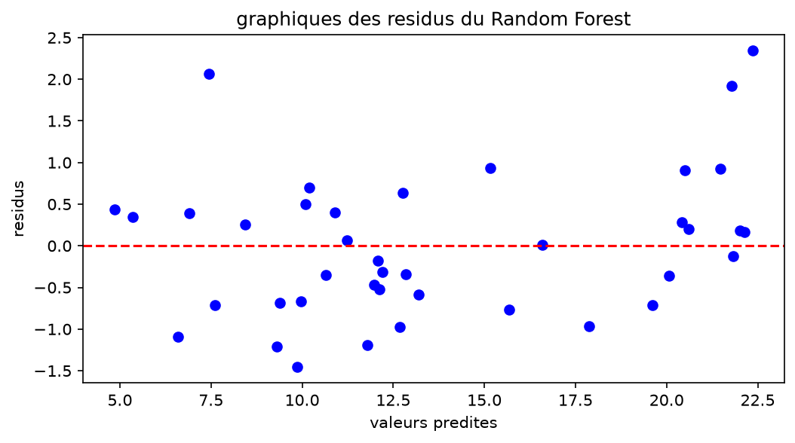

# Sales Prediction
**Source** : [Advertising.csv sur Kaggle](https://www.kaggle.com/datasets/anairamcosta/advertising?select=Advertising.csv)

**Oasis Infobyte, Data Science Internship (OIBSIP), Task 2**

## Comprendre le projet

### Le problème
Une entreprise investit dans la publicité sur trois canaux : la **télévision**, la **radio** et le **journal**. Elle veut savoir combien de ventes elle peut espérer selon ses budgets, et surtout quel canal compte le plus. Un responsable marketing dispose d'un budget limité : identifier les canaux les plus liés aux ventes lui permet de décider où investir et quels postes réduire.

### Le type de tâche
Il s'agit d'un problème de **régression supervisée** : le modèle apprend à partir d'exemples connus (budgets et ventes observées) pour prédire une **valeur numérique**, les ventes.

### Ce qu'on cherche à savoir
- Les budgets publicitaires sont-ils liés aux ventes ?
- Quel canal a le plus d'impact ?
- Quelle précision peut-on atteindre ?
- Un modèle simple suffit-il, ou faut-il un modèle plus complexe ?

### Les deux modèles comparés
- **Régression linéaire** : modèle de référence. Chaque canal reçoit un coefficient qui indique de combien les ventes varient quand son budget augmente. Simple et facile à interpréter.
- **Random Forest** : plusieurs arbres de décision dont on moyenne les prédictions. Il capte des relations plus complexes, mais il est moins lisible.

### Les métriques utilisées
- **MAE** : erreur moyenne, en unités de ventes.
- **RMSE** : comme la MAE, mais pénalise davantage les grosses erreurs.
- **R²** : part de la variabilité des ventes expliquée par le modèle (1 = parfait).

## Dataset

**Source** : [Advertising.csv sur Kaggle](https://www.kaggle.com/datasets/anairamcosta/advertising?select=Advertising.csv)

Le jeu de données « Advertising » est un classique de l'apprentissage statistique. Chaque ligne correspond à un **marché** pour lequel on connaît les budgets publicitaires investis sur trois canaux et les ventes du produit observées.

Nombre d'observations 200 
Variables utilisées  4 (3 explicatives, 1 cible) 
Valeurs manquantes aucune 0
Colonne supprimée  `Unnamed: 0` 
 
### Particularités des données
- Les budgets n'ont pas la même échelle (TV jusqu'à ~300, radio jusqu'à ~50) : la standardisation est nécessaire pour comparer les coefficients.
- `newspaper` a une distribution asymétrique, avec un maximum de 114 éloigné du reste des valeurs.
- La TV est indépendante des deux autres canaux (corrélation d'environ 0,05), alors que radio et journal sont légèrement liés (0,35).

## ANALYSE APRES L"EDA 
La TV et la radio montrent une relation positive avec les ventes, la TV étant la plus nette. Le journal ne montre pas de relation claire.

### Ventes en fonction de chaque canal
La droite de tendance est la plus raide pour la TV, avec des points assez proches. Pour le journal, elle est presque plate et le nuage éparpillé.

### Corrélations
Corrélation avec les ventes : TV 0,78, radio 0,58, newspaper 0,23. Radio et journal sont légèrement liés entre eux (0,35), ce qui peut expliquer le faible lien apparent du journal.

## Méthodologie

1. Chargement et nettoyage des données
2. Analyse exploratoire : statistiques, pairplot, nuages de points, corrélations
3. Découpage train/test 80/20 (`random_state=42`) : 160 observations d'entraînement, 40 de test
4. Régression linéaire sur variables standardisées (scaler ajusté sur le train uniquement)
5. Random Forest (100 arbres, profondeur maximale 5)
6. Évaluation sur le test et par validation croisée à 5 plis
7. Analyse des résidus et de l'importance des variables

## Résultats
Le Random Forest est meilleur sur toutes les métriques, et l'écart se maintient en validation croisée.

### Quel canal a le plus d'impact ?
Les deux modèles donnent le même classement : **TV > radio >> journal**. Les coefficients ont été standardisés pour être comparables, car les budgets n'ont pas la même échelle.

### Analyse des résidus
Les erreurs du Random Forest sont réparties de part et d'autre de zéro, sans courbe nette : elles sont globalement aléatoires. Le modèle tend toutefois à sous-estimer légèrement les ventes les plus élevées. 

## Conclusion

La TV est le canal le plus associé aux ventes, suivie de la radio. Le journal apporte très peu une fois les deux autres canaux pris en compte. Le Random Forest est le modèle retenu.

## Outils

Python, pandas, NumPy, scikit-learn, matplotlib, seaborn, Jupyter Notebook

## Auteur

MOUTCHI MARIAMNE, www.linkedin.com/in/mariamne-adélaïde-moutchi-a5b187245