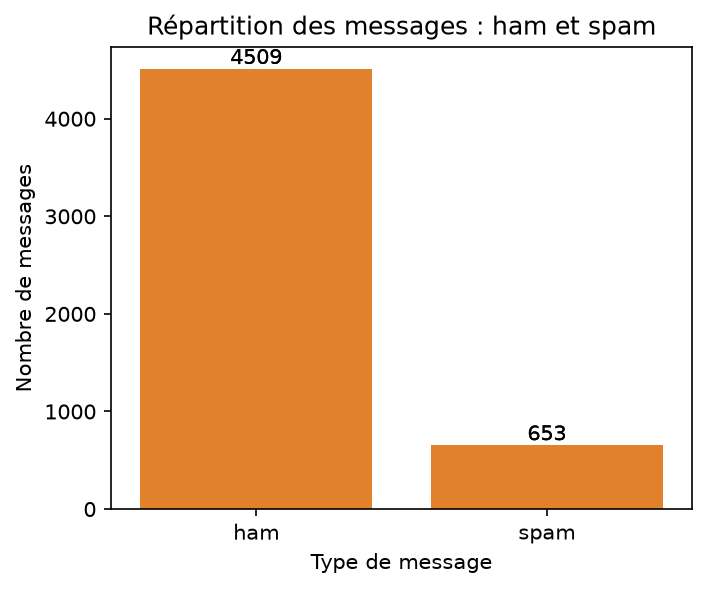
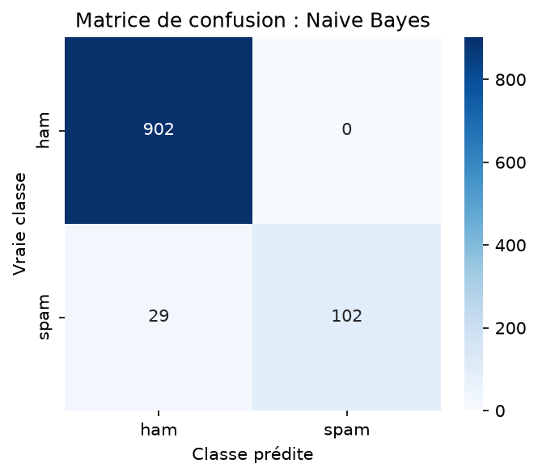
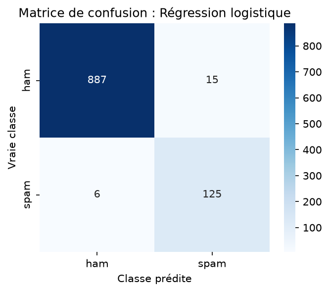
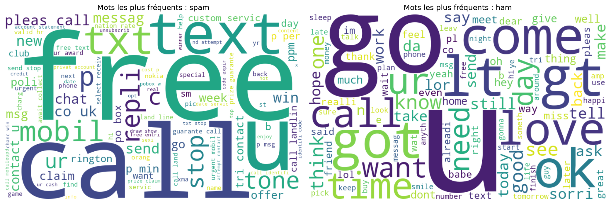

# Email Spam Detection

**Oasis Infobyte, Data Science Internship (OIBSIP), Task 3**

## Comprendre le projet

### Le problème
Chaque jour, des messages frauduleux (arnaques, faux concours, liens malveillants) arrivent dans les messageries. Le but est de construire un filtre capable de reconnaître automatiquement un **spam** parmi des messages **légitimes** (appelés *ham*), à partir du seul texte du message.

### Le type de tâche
Il s'agit d'une **classification binaire de texte** (traitement du langage naturel). Un modèle ne lit pas des mots mais des nombres : il faut donc nettoyer le texte, puis le transformer en vecteurs avant d'entraîner un classifieur. On garde 20 % des messages de côté (jeu de test) pour évaluer le modèle sur des messages qu'il n'a jamais vus.

### Ce qu'on cherche à savoir
- Peut-on distinguer un spam d'un message légitime à partir de son texte ?
- Quel modèle détecte le mieux les spams ?
- Quel est le compromis entre spams non détectés et messages légitimes bloqués ?
- Pourquoi l'accuracy seule est-elle trompeuse ici ?

### Les modèles comparés
- **Multinomial Naive Bayes** : modèle classique du texte, qui estime la probabilité d'un message d'être spam d'après les mots qu'il contient.
- **Régression logistique** (`class_weight="balanced"`) : modèle linéaire qui attribue un poids à chaque mot. L'option `balanced` pénalise davantage les erreurs sur la classe spam, plus rare.

### Les métriques utilisées
- **Accuracy** : proportion de messages bien classés.
- **Precision (spam)** : parmi les messages classés spam, la part qui en sont vraiment.
- **Recall (spam)** : parmi les vrais spams, la part détectée.
- **F1-score** : compromis entre precision et recall.
- **Matrice de confusion** : montre les faux positifs (message légitime bloqué) et les faux négatifs (spam qui passe).

## Dataset
**Source** : [SMS Spam Collection Dataset sur Kaggle](https://www.kaggle.com/datasets/uciml/sms-spam-collection-dataset) (jeu de données original : [UCI Machine Learning Repository](https://archive.ics.uci.edu/ml/datasets/SMS+Spam+Collection))

### Contexte
La SMS Spam Collection est un ensemble de messages SMS étiquetés, collectés pour la recherche sur le spam par SMS. Elle contient 5 574 messages en anglais, identifiés comme **ham** (légitime) ou **spam**. Le fichier `spam.csv` utilisé ici en contient 5 572.

### Contenu
Le fichier contient un message par ligne. Chaque ligne comporte deux colonnes :
- `v1` : l'étiquette (`ham` ou `spam`) ;
- `v2` : le texte brut du message.

Trois colonnes supplémentaires (`Unnamed: 2`, `Unnamed: 3`, `Unnamed: 4`) sont presque vides ; elles sont supprimées. Le fichier est lu avec l'encodage `latin-1`.

### Origine des messages
Le corpus rassemble quatre sources de recherche libres d'accès :
- **425 spams** extraits manuellement de [Grumbletext](http://www.grumbletext.co.uk/), un forum britannique où des utilisateurs de téléphones portables signalent publiquement des spams SMS, le plus souvent sans reproduire le message reçu. Repérer le texte des spams dans ces signalements est une tâche longue, qui demande d'analyser des centaines de pages web.
- **3 375 messages légitimes** tirés au hasard du [NUS SMS Corpus](http://www.comp.nus.edu.sg/~rpnlpir/downloads/corpora/smsCorpus/), environ 10 000 messages légitimes collectés pour la recherche au département d'informatique de l'Université nationale de Singapour. Ils proviennent surtout de Singapouriens, principalement des étudiants, qui savaient que leurs contributions seraient rendues publiques.
- **450 messages légitimes** issus de la [thèse de doctorat de Caroline Tagg](http://etheses.bham.ac.uk/253/1/Tagg09PhD.pdf).
- Le [SMS Spam Corpus v.0.1 Big](http://www.esp.uem.es/jmgomez/smsspamcorpus/), qui apporte 1 002 messages légitimes et 322 spams.

### Remerciements et référence
Le jeu de données original est disponible sur [UCI](https://archive.ics.uci.edu/ml/datasets/SMS+Spam+Collection). Les créateurs demandent de citer l'article ci-dessous et la page web <http://www.dt.fee.unicamp.br/~tiago/smsspamcollection/> si le jeu de données est utile.

Almeida, T.A., Gómez Hidalgo, J.M., Yamakami, A. *Contributions to the study of SMS spam filtering: new collection and results.* Proceedings of the 2011 ACM Symposium on Document Engineering (DocEng'11), Mountain View, CA, 2011.

### Question posée
Peut-on construire un modèle de prédiction qui classe avec précision les textes qui sont du spam ?

### Limites du jeu de données
- **Sources hétérogènes** : ham et spam viennent de collectes différentes, donc le modèle peut apprendre le style de la source autant que la nature du spam.
- **Langue et contexte** : messages en anglais, principalement britanniques et singapouriens, d'une époque ancienne. Les résultats ne se généralisent pas forcément à d'autres SMS.
- **Classes déséquilibrées** : environ 87 % de ham.

## Nettoyage des données

- **Valeurs manquantes** : aucune dans `label` et `message`.
- **Doublons** : 403 supprimés avant le découpage, pour qu'un même message ne se retrouve pas dans le train et le test. Il reste 5 169 messages.
- **Messages vides** : 7 messages (tous ham) ne contenaient plus aucun mot après nettoyage du texte ; ils sont supprimés.
- **Classes finales** : 5 162 messages, dont 4 509 ham (87,3 %) et 653 spam (12,7 %).

Un modèle qui répondrait toujours « ham » obtiendrait 87,3 % d'accuracy sans détecter aucun spam. L'accuracy seule est donc trompeuse : l'évaluation s'appuie sur la precision, le recall et le F1-score de la classe spam.

## Prétraitement du texte

Chaque message passe par cinq étapes :

1. **Minuscules** : « Free » et « free » deviennent le même mot.
2. **Retrait de la ponctuation et des chiffres** : seules les lettres sont gardées.
3. **Stopwords anglais** : suppression des mots très courants (the, is, to...).
4. **Stemming (Porter)** : chaque mot est ramené à sa racine (`winning` devient `win`).
5. **Recollage** en une chaîne `message_clean`.

**Exemple** : « Ok lar... Joking wif u oni... » devient « ok lar joke wif u oni ».

**Ce que le nettoyage fait perdre** : les chiffres et symboles (`£1000`, `150p`, `2`), souvent des indices de spam. Le stemming produit aussi des racines étranges (`entri`, `crazi`).

## Découpage et TF-IDF

- **Découpage 80/20** (`random_state=42`, `stratify=y`) : 4 129 messages d'entraînement et 1 033 de test. La proportion de spam est conservée (12,6 % en train, 12,7 % en test).
- **TF-IDF** : chaque message devient un vecteur de poids, un par mot du vocabulaire.
  - **TF** : combien de fois un mot apparaît dans le message.
  - **IDF** : à quel point le mot est rare dans l'ensemble des messages.
  - **TF-IDF = TF × IDF** : un mot pèse lourd s'il est fréquent dans ce message mais rare ailleurs.
- Le vocabulaire (5 527 mots) est appris sur le train uniquement, puis appliqué au test, pour éviter toute fuite de données. Formes : (4 129, 5 527) en train et (1 033, 5 527) en test.

## Résultats

Les deux modèles sont évalués sur le même jeu de test (1 033 messages, dont 131 spams). Les métriques portent sur la classe spam.

| Métrique | Naive Bayes | Régression logistique (`balanced`) |
|---|---|---|
| Accuracy | 0,972 | **0,980** |
| Precision | **1,00** | 0,89 |
| Recall | 0,78 | **0,95** |
| F1-score | 0,88 | **0,92** |
| Faux positifs (ham bloqués) | 0 | 15 |
| Faux négatifs (spams non détectés) | ≈ 29 | 6 |

### Matrices de confusion

Naive Bayes ne bloque aucun message légitime mais laisse passer environ un spam sur cinq. La régression logistique équilibrée détecte 125 spams sur 131, au prix de 15 messages légitimes bloqués.

## Pourquoi le recall est important pour détecter le spam

Le recall mesure la part des vrais spams que le modèle détecte. Un recall faible laisse passer des messages frauduleux (arnaques, liens malveillants) jusqu'à l'utilisateur.

Il faut cependant l'équilibrer avec la precision : bloquer un message légitime (faux positif) peut aussi coûter cher. Naive Bayes a une precision de 1,00 mais un recall de 0,78 : il est très prudent. La régression logistique équilibrée détecte 125 spams sur 131 mais bloque 15 messages légitimes. Le choix dépend du coût relatif de ces deux erreurs ; le F1-score résume ce compromis.

## Conclusion

La **régression logistique équilibrée** est retenue : elle obtient la meilleure accuracy (0,980), le meilleur recall (0,95) et le meilleur F1-score (0,92). Pour un filtre anti-spam, laisser passer des messages frauduleux est le risque principal. Naive Bayes reste préférable si l'on veut éviter à tout prix de bloquer un message légitime.

## nuages de mots

Le vocabulaire du spam (`free`, `claim`, `win`, `prize`, `urgent`, tarifs et numéros surtaxés) diffère nettement de celui des messages légitimes (conversation courante : `go`, `come`, `love`, `ok`). Certains mots, comme `call`, apparaissent dans les deux classes : la fréquence seule ne suffit pas, d'où l'intérêt du TF-IDF et du modèle.

## Outils

Python, pandas, NumPy, scikit-learn, NLTK, WordCloud, matplotlib, seaborn, Jupyter Notebook

## Auteur

MOUTCHI MARIAMNE, www.linkedin.com/in/mariamne-adélaïde-moutchi-a5b187245